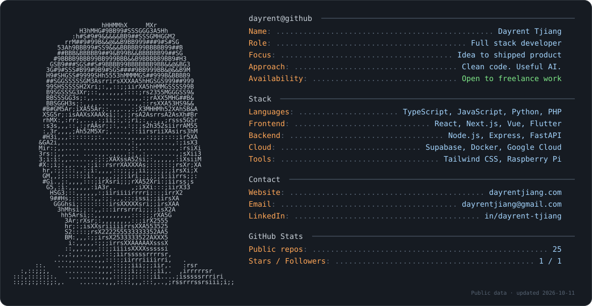

<picture>
  <source media="(prefers-color-scheme: dark)" srcset="assets/profile-dark.svg">
  <source media="(prefers-color-scheme: light)" srcset="assets/profile-light.svg">
  
</picture>

  <a href="https://dayrentjiang.com">Website</a> ·
  <a href="https://linkedin.com/in/dayrent-tjiang">LinkedIn</a> ·
  <a href="mailto:dayrentjiang@gmail.com">Email</a>

About me · plain text

I'm **Dayrent Tjiang**, a full stack developer. I build things end to end, from idea to shipped product, and turn complex problems into clean implementations.

- I work across the whole stack: frontend, backend, and cloud.
- I integrate AI where it helps and pick the tool that fits the problem.
- I care about clean code and products that feel good to use.
- Open to freelance work and interesting problems.

**Stack:** TypeScript, JavaScript, Python, PHP, React, Next.js, Vue, Flutter, Node.js, Express, FastAPI, Tailwind CSS, Supabase, Docker, Google Cloud, and Raspberry Pi.

More on [dayrentjiang.com](https://dayrentjiang.com), including internal systems not shown publicly.

